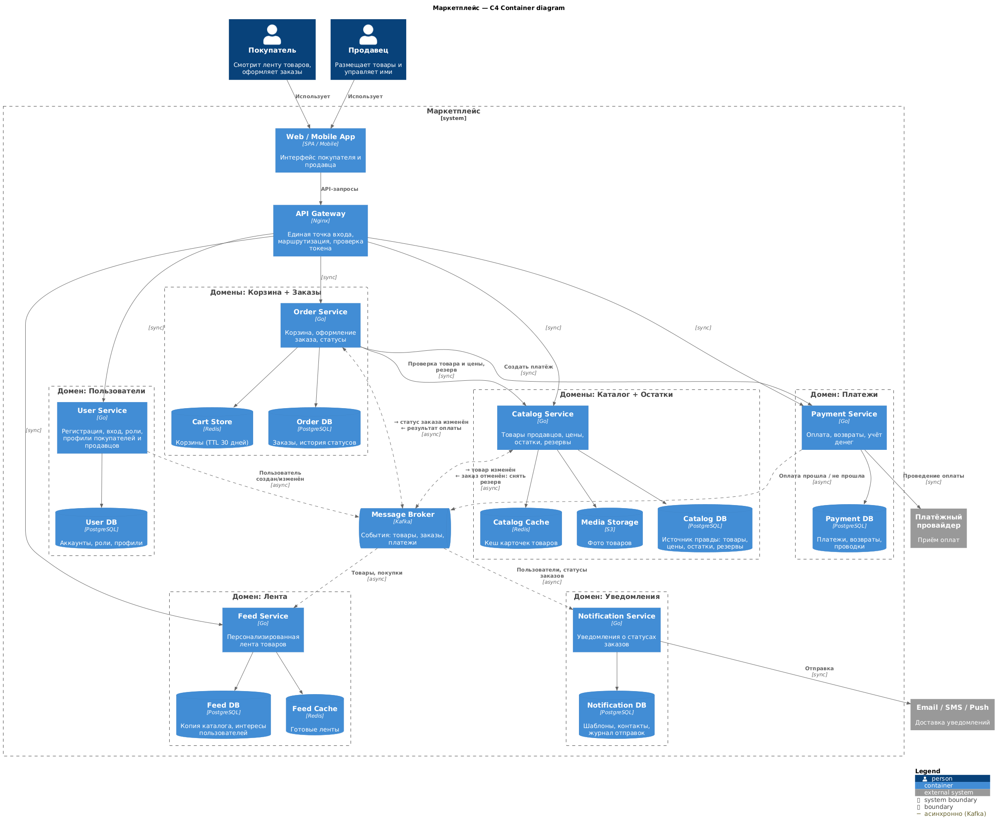
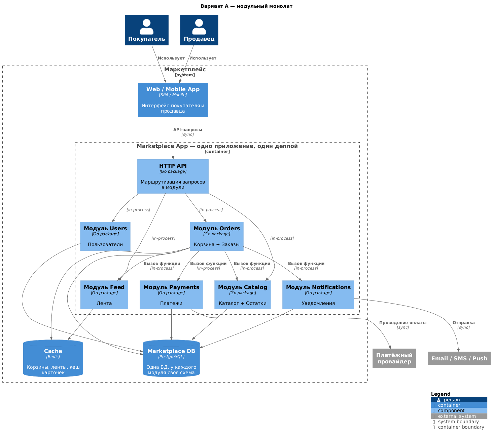

# Маркетплейс — архитектура (ДЗ-1)

Платформа, на которой продавцы размещают товары, а покупатели оформляют заказы.

## Содержание

- [Маркетплейс — архитектура (ДЗ-1)](#маркетплейс--архитектура-дз-1)
  - [Содержание](#содержание)
  - [1. Запуск](#1-запуск)
  - [2. C4 Container диаграмма](#2-c4-container-диаграмма)
  - [3. Домены](#3-домены)
  - [4. Распределение доменов по сервисам](#4-распределение-доменов-по-сервисам)
  - [5. Владение данными](#5-владение-данными)
  - [6. Взаимодействие сервисов](#6-взаимодействие-сервисов)
    - [Синхронные вызовы](#синхронные-вызовы)
    - [Асинхронные события (Kafka)](#асинхронные-события-kafka)
    - [Сценарии](#сценарии)
  - [7. Брокер сообщений (Kafka)](#7-брокер-сообщений-kafka)
  - [8. Альтернативные варианты декомпозиции](#8-альтернативные-варианты-декомпозиции)
  - [9. Trade-off’ы вариантов](#9-trade-offы-вариантов)
  - [10. Обоснование финального выбора](#10-обоснование-финального-выбора)

---

## 1. Запуск

Нужен Docker с Docker Compose.

```bash
docker compose up -d --build
curl -i http://localhost:8080/health
```

Ответ:

```
HTTP/1.1 200 OK
{"status":"ok"}
```

Docker сам проверяет `/health` каждые 10 секунд (healthcheck в `docker-compose.yml`). Статус контейнера можно посмотреть командой `docker compose ps`, ожидается `Up (healthy)`.

Остановить: `docker compose down`.

Реализован один сервис, `catalog-service` (Go, [services/catalog-service](services/catalog-service)). Бизнес-логики в нём нет, только `GET /health`.

---

## 2. C4 Container диаграмма



Исходник: [docs/c4-container.puml](docs/c4-container.puml) (C4-PlantUML).

Как читать:

- **Пунктирная рамка** — сервис и его база данных. В заголовке рамки указаны домены, которые в него входят.
- **Сплошная стрелка** (`sync`) — синхронный вызов: вызывающий ждёт ответа.
- **Пунктирная стрелка** — асинхронное событие через Kafka. На двусторонних стрелках `→` значит «сервис публикует», `←` значит «сервис получает».

---

## 3. Домены

| Домен | Зона ответственности |
| --- | --- |
| **Пользователи** | Регистрация и вход, роли (покупатель / продавец), профиль покупателя, профиль магазина продавца |
| **Каталог** | Товары продавцов: описание, категории, цены, фото; публикация и снятие с продажи |
| **Остатки** | Сколько единиц товара в наличии, резерв под заказ, списание после оплаты |
| **Лента** | Персонализированная подборка товаров для пользователя на основе его просмотров и покупок |
| **Корзина** | Товары, которые покупатель собирается купить |
| **Заказы** | Оформление заказа и его жизненный цикл: создан → ожидает оплаты → оплачен → отправлен → доставлен / отменён |
| **Платежи** | Проведение оплаты через платёжного провайдера, возвраты, учёт денег и комиссии площадки |
| **Уведомления** | Сообщения покупателю и продавцу о смене статуса заказа (email / SMS / push) |

---

## 4. Распределение доменов по сервисам

| Сервис | Домены | Почему так |
| --- | --- | --- |
| **User Service** | Пользователи | Покупатель и продавец — это один аккаунт с разными ролями, поэтому один сервис. Нагрузка низкая, данные меняются редко. |
| **Catalog Service** | Каталог + Остатки | Остаток — свойство конкретного товара. При резерве нужно **одной транзакцией** проверить, что товар существует, продаётся и есть в наличии. В одной БД это просто, а в двух сервисах потребовалась бы распределённая координация. |
| **Feed Service** | Лента | Ленту открывают постоянно, поэтому у неё самая высокая нагрузка и её нужно масштабировать отдельно. Нужен свой кеш готовых лент. Небольшая задержка данных допустима. Если лента сломается, покупки продолжат работать. |
| **Order Service** | Корзина + Заказы | Корзина — это черновик заказа: те же позиции и те же данные. При оформлении корзина превращается в заказ внутри одного сервиса. |
| **Payment Service** | Платежи | Деньги требуют строгой точности и аудита, а требования безопасности у платежей выше, чем у остальных сервисов. Изоляция сужает зону, к которой эти требования применяются. |
| **Notification Service** | Уведомления | Работает только по событиям и зависит от внешних провайдеров, которые бывают нестабильны. Сбой отправки письма не должен ломать заказ. |
| **API Gateway** | — | Инфраструктура без бизнес-логики: единая точка входа, маршрутизация, проверка токена. |

**Логика разбиения.** Граница сервиса проходит там, где меняются требования к нагрузке, надёжности и согласованности данных:

- домены, которые **тесно связаны данными и транзакциями**, объединены (Каталог + Остатки, Корзина + Заказы);
- домены с **разными требованиями** разведены по разным сервисам (высоконагруженная Лента, строгие Платежи, асинхронные Уведомления).

---

## 5. Владение данными

У каждого сервиса **свои хранилища**, и обращаться к ним может только он. **Разделяемых БД нет:** сервисы не читают чужие таблицы и не делают JOIN между базами. Данные другого сервиса можно получить двумя способами:

- запросом к его API;
- из его событий в Kafka, сохранив у себя **копию для чтения**. Источником правды при этом остаётся сервис-владелец.

У сервиса может быть несколько хранилищ, если у его данных разные требования. Главное, что все они принадлежат только ему.

| Сервис | Хранилища | Владеет данными | Копии чужих данных (только чтение) | Отвечает за |
| --- | --- | --- | --- | --- |
| User | PostgreSQL | аккаунты, пароли (хеши), роли, профили покупателей и магазинов | — | аутентификацию и профили |
| Catalog | PostgreSQL, Redis (кеш), S3 | товары, категории, цены, остатки, резервы; фото товаров | — | корректность каталога и остатков |
| Feed | PostgreSQL, Redis | интересы пользователей (PostgreSQL), готовые ленты (Redis) | товары (из событий Catalog), покупки (из событий Order) | персонализированную ленту |
| Order | Redis, PostgreSQL | корзины (Redis); заказы, позиции заказа с ценой на момент покупки, история статусов (PostgreSQL) | — | корзину и жизненный цикл заказа |
| Payment | PostgreSQL | платежи, возвраты, бухгалтерские проводки | — | проведение и учёт денег |
| Notification | PostgreSQL | шаблоны сообщений, журнал отправок | контакты пользователей (из событий User) | доставку уведомлений |

### Почему у сервисов такие хранилища

Хранилище выбирается по характеру данных: как часто их читают и меняют, насколько критична их потеря и какие запросы к ним нужны.

| Сервис | Решение | Почему |
| --- | --- | --- |
| **User** | только PostgreSQL | Нагрузка низкая. Токен проверяется на API Gateway без обращения к User Service, поэтому сервис не получает запрос на каждое действие пользователя, и кеш не нужен. |
| **Catalog** | PostgreSQL + Redis-кеш + S3 | Карточки товаров читают очень часто, а меняют редко: это классический случай для кеша. Источник правды — PostgreSQL, кеш сбрасывается при изменении товара. **Остатки и резервы всегда читаются из PostgreSQL**, иначе можно продать товар, которого уже нет. Фото — большие файлы, им место в объектном хранилище (S3), а не в БД. |
| **Feed** | PostgreSQL + Redis | **PostgreSQL** хранит копию каталога (категория, цена, наличие, популярность) и интересы пользователей. Из этих данных обычным SQL-запросом подбираются товары: «из любимых категорий пользователя, в наличии, по популярности». **Redis** хранит уже собранные ленты. Ленту открывают очень часто, поэтому её считают заранее (или при первом запросе) и дальше отдают из Redis за миллисекунды. Если Redis очистится, ленты просто пересчитаются из PostgreSQL. |
| **Order** | Redis (корзины) + PostgreSQL (заказы) | Это **не кеш**, а два хранилища для разных данных. Корзина — черновик: её постоянно меняют, потерять её не критично, а брошенные корзины удаляются сами по сроку жизни (TTL 30 дней). Заказ — финансовый документ: нужны транзакции и многолетнее хранение. Держать корзины в PostgreSQL с кешем в Redis хуже: появятся две копии одних данных и проблема их согласования. |
| **Payment** | только PostgreSQL, **кеша нет намеренно** | Устаревший статус платежа из кеша опасен: можно дважды провести оплату или отгрузить неоплаченный заказ. Нагрузка низкая, платежи бывают только при оформлении заказа. |
| **Notification** | только PostgreSQL | Работает асинхронно по событиям, скорость ответа пользователю не важна. Журнал отправок растёт, поэтому старые записи периодически удаляются. |

---

## 6. Взаимодействие сервисов

**Синхронно** — только когда пользователю нужен ответ прямо сейчас. **Асинхронно** (Kafka) — всё остальное, чтобы сервисы не зависели от доступности друг друга.

### Синхронные вызовы

| Кто | Кому | Зачем |
| --- | --- | --- |
| Клиент | API Gateway | все запросы пользователей |
| API Gateway | User, Catalog, Feed, Order, Payment | передать запрос нужному сервису |
| Order | Catalog | проверить товар и цену при добавлении в корзину; зарезервировать товар при оформлении. Покупатель должен сразу узнать, есть ли товар |
| Order | Payment | создать платёж и вернуть покупателю ссылку на оплату |
| Payment | Платёжный провайдер | создать платёж и получить ссылку на оплату |
| Платёжный провайдер | Payment | сообщить результат оплаты (вебхук) |
| Notification | Email / SMS / Push | отправить сообщение |
| Клиент | Media Storage (S3, через CDN) | загрузить фото товаров по ссылкам из карточек, минуя сервисы |

### Асинхронные события (Kafka)

| Кто публикует | Событие | Кто получает | Что делает получатель |
| --- | --- | --- | --- |
| User | пользователь создан / изменён | Notification | обновляет контакты для рассылки |
| Catalog | товар изменён | Feed | обновляет копию каталога для ленты |
| Payment | оплата прошла / не прошла | Order | переводит заказ в «оплачен» или «отменён» |
| Order | статус заказа изменён | Notification | уведомляет покупателя и продавца |
| Order | статус заказа изменён | Feed | учитывает покупку в интересах пользователя |
| Order | заказ оплачен | Catalog | превращает резерв в окончательное списание товара |
| Order | заказ отменён | Catalog | снимает резерв, товар снова доступен для покупки |

### Сценарии

#### 1. Пользователь открыл главную страницу с лентой

1. App → Gateway → **Feed** (sync): `GET /feed`. Gateway проверяет токен и передаёт `user_id`.
2. Feed ищет готовую ленту пользователя в Redis.
   - **Лента есть** — сразу отдаёт её.
   - **Ленты нет** — берёт из своей PostgreSQL интересы пользователя, выбирает из копии каталога подходящие товары в наличии, сортирует по популярности, сохраняет ленту в Redis на 10–15 минут и отдаёт.
   - **Новый пользователь или гость** — интересов нет, отдаётся общий список популярных товаров.
3. Приложение показывает карточки, а фото загружает по ссылкам напрямую из S3 (через CDN).
4. Когда пользователь листает ленту и открывает товары, приложение в фоне отправляет в Feed события «посмотрел товар». Из них пополняются интересы пользователя.

Catalog при этом не вызывается: самый частый запрос системы обслуживается копией каталога в Feed. Цена в ленте может отставать на несколько секунд. Это допустимо, потому что актуальная цена проверяется при добавлении в корзину и при оформлении.

#### 2. Пользователь добавил товар в корзину

1. App → Gateway → **Order** (sync): `POST /cart/items`.
2. Order → **Catalog** (sync): товар существует, продаётся, есть в наличии? какая цена? Остатки читаются из PostgreSQL, не из кеша.
3. Order записывает товар в корзину пользователя в Redis и продлевает её срок жизни до 30 дней.
4. Покупатель получает обновлённую корзину.

Товар **не резервируется**: корзина — только намерение купить. Иначе товары «висели» бы в брошенных корзинах.

#### 3. Пользователь сразу оформил и оплатил заказ

**Оформление (sync, пользователь ждёт ответа):**

1. App → Gateway → **Order**: `POST /orders`. Order берёт корзину из Redis.
2. Order → **Catalog**: зарезервировать товар. Catalog **одной транзакцией** проверяет, что товар продаётся и остатка хватает, уменьшает доступный остаток, создаёт резерв на 15 минут и возвращает актуальную цену. Если товар закончился, покупатель сразу получает ошибку.
3. Order создаёт заказ со статусом «ожидает оплаты». Цена фиксируется в заказе: если продавец потом её поменяет, заказ не изменится.
4. Order → **Payment**: создать платёж. `order_id` служит ключом идемпотентности, поэтому повторный запрос не создаст второй платёж. Payment получает у платёжного провайдера ссылку на оплату.
5. Покупатель получает номер заказа и ссылку и переходит на страницу оплаты провайдера. Данные карты к нам не попадают.

**Оплата (async, пользователь ничего не ждёт):**

6. Провайдер присылает Payment вебхук «оплата прошла». Payment отмечает платёж как успешный, записывает проводки (деньги покупателя, комиссия площадки, сумма к выплате продавцу) и публикует `payment.succeeded`.
7. **Order** получает событие, переводит заказ в «оплачен», очищает корзину и публикует «заказ оплачен».
8. Это событие параллельно получают три сервиса:
   - **Catalog** превращает резерв в окончательное списание;
   - **Notification** отправляет покупателю «Заказ оплачен», а продавцу — «Новый заказ»;
   - **Feed** учитывает покупку в интересах пользователя и сбрасывает его готовую ленту.
9. Покупатель возвращается в приложение и видит статус «Оплачен».

**Если что-то пошло не так:**

- **Оплата не прошла:** Payment публикует `payment.failed`. Order отменяет заказ и публикует «заказ отменён», Catalog снимает резерв.
- **Покупатель не оплатил за 15 минут:** Order отменяет заказ по таймеру, дальше всё то же самое. Страховка: Catalog сам удаляет просроченные резервы, даже если событие об отмене не пришло.
- **Notification или Feed недоступны:** заказ всё равно оплачивается. События дождутся их в Kafka и будут обработаны, когда сервисы поднимутся.

Поэтому сбой Notification или Feed не мешает оформлять заказы: они не участвуют в синхронной цепочке.

---

## 7. Брокер сообщений (Kafka)

### Что это и как работает

Kafka — это **журнал событий**. Сервис, у которого что-то произошло, записывает событие в журнал (**топик**). Другие сервисы читают этот топик и реагируют. Публикующий сервис не знает, кто и когда прочитает событие, а читающие не обращаются к нему напрямую.

```
Order Service ──публикует──▶ [ топик order.events ] ──читает──▶ Notification Service
                                                    ──читает──▶ Feed Service
                                                    ──читает──▶ Catalog Service
```

Пример события:

```json
{
  "event_id": "7f1c…",
  "type": "order.status_changed",
  "order_id": "123",
  "status": "PAID",
  "occurred_at": "2026-10-02T12:00:00Z"
}
```

### Зачем он нужен

1. **Сервисы не зависят друг от друга.** Order не знает про Notification и Feed. Чтобы добавить нового получателя (например, аналитику), Order менять не нужно, достаточно подписаться на топик.
2. **Сбой одного сервиса не ломает другие.** Если Notification Service упал, события не теряются: они лежат в Kafka и будут обработаны, когда сервис поднимется. Заказы при этом продолжают оформляться.
3. **Пики нагрузки сглаживаются.** В распродажу событий становится в разы больше. Kafka их накапливает, а получатели обрабатывают в своём темпе.
4. **События можно перечитать.** Kafka хранит события несколько дней. Если копия каталога в Feed испортилась, её можно пересобрать, прочитав топик заново.

### Топики

У каждого топика один **владелец** — только он туда пишет.

| Топик | Кто пишет | Кто читает | События |
| --- | --- | --- | --- |
| `user.events` | User | Notification | пользователь создан / изменён |
| `catalog.events` | Catalog | Feed | товар создан / изменён / снят с продажи, изменился остаток |
| `order.events` | Order | Catalog, Notification, Feed | статус заказа изменён, заказ отменён |
| `payment.events` | Payment | Order | оплата прошла / не прошла, возврат выполнен |

### Правила работы

- **Каждый сервис получает все события топика.** Каждый сервис читает топик как отдельная группа (consumer group), поэтому событие `order.events` получат и Notification, и Feed, и Catalog. Если у сервиса несколько экземпляров, они делят события между собой, и каждое событие обрабатывается один раз.
- **Порядок событий одного заказа сохраняется.** Ключ события — `order_id`. Все события одного заказа попадают в одну партицию топика и читаются в том порядке, в котором были записаны: «оплачен» не придёт раньше «создан».
- **Событие может прийти дважды** (гарантия доставки at-least-once). Поэтому получатель запоминает `event_id` обработанных событий и повторы пропускает. Иначе, например, покупатель получил бы два одинаковых письма.
- **Событие не теряется при падении сервиса (transactional outbox).** Проблема: сервис сохранил заказ в БД и упал, не успев отправить событие в Kafka. Решение: сервис записывает событие в таблицу `outbox` **в той же транзакции**, что и сам заказ. Отдельный фоновый процесс читает `outbox` и отправляет события в Kafka. Заказ и событие сохраняются либо оба, либо ни одно.

### Что через брокер не идёт

Запросы, на которые нужен ответ прямо сейчас: «есть ли товар», «создай платёж и дай ссылку». Брокер не возвращает ответ, поэтому для них используются синхронные вызовы (см. раздел 6).

### Почему Kafka

Нужны хранение и повторное чтение событий (пересборка копий данных), порядок событий по ключу и высокая пропускная способность. RabbitMQ — классическая очередь: сообщение удаляется после прочтения, и перечитать его нельзя.

---

## 8. Альтернативные варианты декомпозиции

Рассмотрены два принципиально разных варианта: одно приложение и набор независимых сервисов.

### Вариант A — модульный монолит



Исходник: [docs/c4-variant-a-monolith.puml](docs/c4-variant-a-monolith.puml)

Одно приложение, разделённое на модули по тем же доменам. Модули вызывают друг друга как обычные функции внутри одного процесса. Одна PostgreSQL, у каждого модуля своя схема. Брокер не нужен. Один деплой.

### Вариант B — доменные сервисы (выбран)

Основная диаграмма из [раздела 2](#2-c4-container-диаграмма). 6 отдельных сервисов, у каждого свои хранилища. Домены, которые тесно связаны данными, объединены в один сервис, а домены с разными требованиями разведены по разным. Сервисы общаются синхронными вызовами (когда ответ нужен сразу) и событиями через Kafka (всё остальное).

---

## 9. Trade-off’ы вариантов

### Вариант A — модульный монолит

| Плюсы | Минусы |
| --- | --- |
| Быстро разработать и просто развернуть: одно приложение, одна БД, без брокера | **Нельзя масштабировать ленту отдельно.** У ленты нагрузка на порядки выше, чем у заказов, но масштабировать придётся всё приложение целиком |
| Обычные транзакции: резерв, заказ и платёж можно записать одной транзакцией в одной БД | **Общий радиус отказа.** Ошибка или утечка памяти в модуле ленты роняет всё приложение, включая оформление заказов |
| Просто отлаживать: нет сетевых вызовов, частичных отказов и копий данных | **Платежи в одном процессе со всем остальным.** Требования безопасности к платежам распространяются на весь код |
| Данные всегда согласованы: нет копий, которые отстают от оригинала | **Границы размываются.** В общей БД легко сделать JOIN между схемами разных модулей, и со временем модули срастаются |
| Границы модулей легко поменять: это рефакторинг кода, а не перенос данных между БД | **Один релиз на всё.** Чтобы поправить текст уведомления, нужно передеплоить всю систему |

### Вариант B — доменные сервисы

| Плюсы | Минусы |
| --- | --- |
| **Лента масштабируется отдельно**, и её сбой не мешает покупать | **Сложнее в разработке и эксплуатации:** брокер, outbox, защита от повторных событий, 6 сервисов вместо одного приложения |
| **Платежи изолированы:** строгие требования касаются только одного сервиса | **Нет общей транзакции на весь заказ.** Вместо неё последовательность шагов с отменой при ошибке: не прошла оплата — снять резерв |
| **Границы жёсткие:** у каждого сервиса своя БД, залезть в чужие данные нельзя | **Копии данных отстают.** В ленте товар может ещё показываться несколько секунд после того, как закончился |
| **Независимые релизы:** правка в уведомлениях не требует передеплоя заказов | **Сетевые вызовы могут падать и тормозить.** Нужны таймауты и повторы, а отлаживать сложнее, чем вызовы функций |
| **Резерв атомарный:** товар, цена и остаток лежат в одной БД Catalog | **Order Service критичен.** Без него нельзя оформить заказ, поэтому ему нужны несколько экземпляров и мониторинг |

---

## 10. Обоснование финального выбора

Выбран **вариант B — доменные сервисы**.

1. **У требований кейса разные нефункциональные характеристики.** Персонализированная лента — самая высокая нагрузка, небольшая задержка данных допустима. Платежи требуют строгой точности. Уведомления асинхронны и зависят от внешних провайдеров. Заказы — центральный транзакционный процесс. В монолите эти требования конфликтуют внутри одного приложения и одной БД. В варианте B у каждой группы свой сервис, который масштабируется и настраивается под свои требования.

2. **Покупка не должна зависеть от второстепенных частей.** Оформление заказа синхронно проходит только через Order, Catalog и Payment. Лента и уведомления работают через события, поэтому их сбой не мешает покупать. В монолите так сделать нельзя: всё работает в одном процессе, и падение любого модуля останавливает всё.

3. **Главный минус монолита — отсутствие общей транзакции — у нас ограничен.** Самая чувствительная операция, резерв товара, остаётся одной локальной транзакцией: товар, цена и остаток лежат в одной БД Catalog. Транзакция нужна только между шагами оформления заказа (резерв → оплата), а эти шаги координирует Order Service с явной отменой при ошибке.

4. **Сложность ограничена.** Сервисы нарезаны крупно, по группам доменов, а не по каждой сущности. Шести сервисов достаточно, чтобы закрыть все шесть требований кейса, и при этом их посильно сопровождать небольшой команде.

5. **Вариант B можно развивать дальше.** Если нагрузка вырастет, части сервисов можно выделить, не трогая остальные: остатки из Catalog — в Inventory Service, продавцов из User — в Seller Service.
